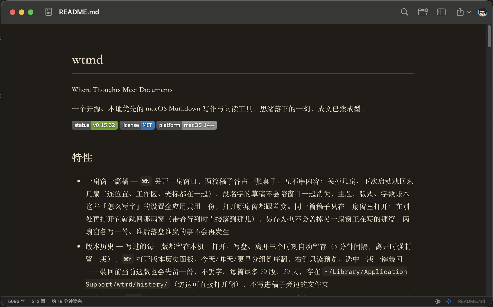

# wtmd

**W**here **T**houghts **M**eet **D**ocuments

一个开源、本地优先的 macOS Markdown 写作与阅读工具。思绪落下的一刻，成文已然成型。

  



## 特性

- **一扇窗一篇稿** — `⌘N` 另开一扇窗口，两篇稿子各占一张桌子，互不串内容；关掉几扇、下次启动就回来几扇（连位置、工作区、光标都在一起），没名字的草稿不会陪窗口一起消失；主题、版式、字数账本这些「怎么写字」的设置全应用共用一份，打开哪扇窗都跟着变。**同一篇稿子只在一扇窗里打开**：在别处再打开它就跳回那扇窗（带着行列时直接落到那儿），另存为也不会盖掉另一扇窗正在写的那篇，两扇窗各写一份、谁后落盘谁赢的事不会再发生
- **版本历史** — 写过的每一版都留在本机：打开、写盘、离开三个时刻自动留存（5 分钟间隔，离开时强制留一版），`⌘Y` 打开版本历史面板，今天/昨天/更早分组倒序翻，右侧只读预览，选中一版一键装回——装回前当前这版也会先留一份，不丢字。每篇最多 50 版、30 天，存在 `~/Library/Application Support/wtmd/history/`（访达可直接打开翻），不写进稿子旁边的文件夹
- **写作日历** — `⌘⇧Y` 打开一年一眼看完：连续天数、本月、今年、最高单日四个数，下面 53 周热力格（今天描边，深色浅色都跟着主题走），点哪天看哪天写了多少；删字的日子画成空心格——不是没写，只是那天在往下走。账本只在本机、留 365 天，不上传任何地方
- **设置窗口** — 工具栏右侧是你的**头像**：设了头像就画图片，没设就画昵称首字（都没有就是一枚人像符号），旁边带上昵称。点开是左侧导航的设置窗口——账户区管昵称与头像，下面「写作 / 外观 / 应用与帮助」三组各管一件事：打字机与每日目标、主题、版式、打印、快捷键、版本与更新。头像只缩到 512 px 存在本机（`Application Support/wtmd/profile/`），不上传、不写进任何文档——这软件没有账号，也就没有云端
- **思绪 ⇄ 成文** — `⌘/` 在源码与预览之间即刻切换；源码是思绪的原貌，预览是思绪的成文，同一窗口、无跳转。打开一篇非空的稿子默认先进成文（读是最常见的意图），新建一篇则保持思绪并点亮专注模式——新建就是要写了。工具栏一个按钮转一圈：思绪 → 成文 → 对照，悬停先说现在在哪、再说点下去去哪
- **文件夹工作区** — 整个文件夹拖进侧栏即为工作区：文件树仅收 Markdown、目录可折叠、随 Finder 变更实时刷新；**树里能动手**——新建文稿/文件夹、行内重命名、拖拽移动、移到废纸篓；在访达里改了名、挪了窝，wtmd 按文件指纹静默跟上，不打扰写作；文件模式编辑自动落盘（防抖保存，切换/新建/退出/关窗前立即冲刷，最后一笔不丢）
- **打字机 + 专注模式** — 打字机让光标永远停在屏幕中部，视线不必追逐；专注让当前段落之外退成浅灰，心流里只有这一段。两者独立开关、可组合（⌥⌘T / ⌥⌘F）
- **⌘K 命令面板** — 模糊搜索直达全部命令（切主题、开关模式、导出、打开最近文件），菜单、工具栏、面板共用同一份命令注册表
- **查找与全文搜索** — `⌘F` 文档内查找替换（区分大小写 / 全词 / 正则，全部替换一步撤销）；`⌘⇧F` 在整个工作区里找一句话，结果按文件分组，回车直达行与列；两处都不做索引，扫的就是磁盘上的纯文本
- **主题系统** — 内置「默认 / 纸墨 / 终端」三套手写主题，另有十套 **base16 社区配色**（夜航、炭火、淡漠、学徒、甜米露、盛世、余烬、石窟画室…中英文界面各成正名）；**卡片式主题库**——设置里每套主题用自身颜色和字体长出一张样张卡（明暗双面主题左右各一半），名称、作者、浅深徽章一目了然，按内置 / base16 / 自定义分组滚动，顶部浅深筛选，点卡即换装；**可视化主题编辑器**——挑任意主题当基底，取色器 + hex 调 16 个颜色、选字体，实时样张预览，保存即装；`.wttheme` 文件夹可在设置里直接选择安装（重名自动顺延），手写拖进主题文件夹同样即装，CSS 变量格式，切换即时生效不丢滚动；预览与**写作区**一起换装——底色、文字颜色、等宽字族都从主题取，明暗两套自动跟随系统。格式细节与外部主题（base16）转换见 [docs/THEMES.md](docs/THEMES.md)
- **图片粘贴即成文** — 截图/拖入图片自动落地 `assets/` 目录并插入相对路径引用，文档目录整体拷贝依然自洽
- **脚注** — `[^id]` 引用与定义，文末自动编号汇总，双向锚点跳转
- **代码高亮** — 预览中 ```lang 围栏代码块按语言着色；本地内嵌 highlight.js（36 种常用语言），离线可用、不外联网，配色由当前主题派生，未识别的语言保持纯文本
- **Mermaid 图表** — ```mermaid 围栏渲染为流程图/时序图，本地内嵌 mermaid，配色随主题变量自适应；渲染失败降级为原代码块并提示错误，打印与导出同样出图
- **数学公式** — `$E=mc^2$` 行内、`$$…$$` 块级，本地内嵌 KaTeX（字体已打包进样式表），离线可用；渲染失败降级为原文本并提示，打印与导出同样出公式；金额 `$5 and $10`、行内代码里的 `$` 不误判
- **实时统计** — 状态栏字数/词数/阅读时长，中英混合口径，Markdown 感知（代码块与 URL 不掺水）；设了每日字数目标后，状态栏再添「今日净增 / 目标」与一条细进度条，达成换强调色，删字会扣回去
- **编辑手感** — 回车自动续列表/引用/任务（空项回车退出列表），Tab / ⇧Tab 缩进与表格跳格（表格里回车补行），输入法组合中一律不拦；从浏览器或 Word 复制的内容粘进来自动转成干净的 Markdown，格式不再丢
- **语法高亮源码编辑器** — 标题、强调、代码、链接、引用、列表一目了然
- **排版级预览** — 阅读级字体版式，浅色/深色主题自动跟随系统；版心宽度、字号、行距可调且即时热更新；代码块 Word Wrap（自动换行）可开关——超长行折行或保持排版横向滚动
- **分栏对照联动** — 分栏里点到哪一段，另一边跟到同一段：写的时候预览跟着光标走，读的时候源码跟着滚动走（不动光标、不抢焦点）
- **大纲导航** — 侧栏自动生成标题层级，点击跳转，滚动时同步高亮当前章节
- **文件管理** — 最近文件、未命名草稿自动保存（重启不丢）、⌘⇧O 打开文件夹；重开应用回到上次的工作区、上次那篇、上次那一段；外部改动冲突未解决时切走，本地版本自动存成副本，状态栏一键取回
- **崩了也说清楚** — 进程被信号打死时，本机当场记下信号、调用栈与最近 40 行操作轨迹（启动/开窗/关窗/打开文档），下次打开用一页说明白发生了什么，可「复制报告」「在访达中显示」，或一键打开已填好标题与正文的 GitHub 新建 issue 页面。报告只存在 `~/Library/Application Support/wtmd/crashes/`，**不含任何正文**、不联网；正常退出不会留下误报
- **更新提示** — 启动时每天最多查一次 GitHub Release，有新版本就在状态栏给一个可点的徽标：点一下直接下载、挂载、换上新版再重启（旧版进废纸篓），也可以只跳去发布页自己下；只读版本号，不上报任何数据，离线或失败时完全静默
- **导出** — 独立 HTML 文件（内联主题）、Word（.docx，标题/列表/表格/代码/图片都保留结构）、打印/存为 PDF（页边距、页码、首行标题可调，字号行距跟屏幕走，段落不拦腰截断）
- **零第三方依赖** — Markdown 解析器完全自研（`WTMarkdownKit`），958 项单元测试覆盖，GitHub Actions 双系统 CI

## 安装

从 [Releases](https://github.com/TonyMistark/wtmd/releases) 下载最新的 `wtmd-<版本>.dmg`，打开后把 wtmd 拖进「应用程序」。

产物为 ad-hoc 签名、未经公证（本仓库没有 Developer ID 证书），在其他机器上**首次打开会被 Gatekeeper 拦截**（提示「无法验证开发者」或「已损坏」）。注意 macOS 15 起「右键 → 打开」已不再能绕过，任选其一：

- **系统设置** › 隐私与安全性 → 找到「已阻止使用 wtmd」→ 点「仍要打开」；
- 或在终端执行：`xattr -cr /Applications/wtmd.app`。

之后可正常打开。本地从源码运行则无此问题。

## 快速开始

```bash
git clone <repo-url> && cd wtmd
swift run
```

或只构建：

```bash
swift build -c release
.build/release/wtmd
```

要求：macOS 14+，Xcode 15+（含 Swift 工具链）。

## 打包

```bash
./make-app.sh     # 生成 dist/wtmd.app（含内嵌前端资源）
./make-dmg.sh     # 生成 dist/wtmd-<版本>.dmg（含背景图布局与安装引导）
```

`make-dmg.sh` 默认对 app 与 DMG 做 ad-hoc 签名（对外分发路径）；有 Developer ID 证书时用 `WTMD_SIGN_IDENTITY="Developer ID Application: …" ./make-dmg.sh`，公证后自行 `notarytool submit` + `stapler staple`。DMG 窗口布局（背景图 + 图标位置）直接写入 `.DS_Store`，不依赖 Finder 自动化；可选依赖 `pip install dmgbuild`（缺省降级为默认视图）。

## 设计哲学

1. **写作即排版** — 源码与预览是同一份文本的两种视图
2. **极简无干扰** — 界面只在需要时出现
3. **纯文本本质** — 底层永远是标准 Markdown（兼容 GFM 方言）
4. **本地优先** — 不强制云端、不要求账号，文件属于你自己
5. **开放可塑** — MIT 协议，主题开放

详见 [docs/PRODUCT.md](docs/PRODUCT.md)。

## 支持

`WTMarkdownKit` 可独立用于 Markdown → HTML 渲染与大纲提取：

```swift
import WTMarkdownKit

let result = WTMarkdown.render("# 标题\n\n正文 **加粗**")
result.html    // "<h1 id=\"标题\">标题</h1>\n<p>正文 <strong>加粗</strong></p>"
result.outline // [OutlineItem(level: 1, text: "标题", slug: "标题", line: 0)]
```

已覆盖：标题、段落、粗体/斜体/删除线、行内代码、行内/块级数学（`$…$`、`$$…$$`）、链接、图片、自动链接、硬换行、无序/有序/嵌套/任务列表、引用（可嵌套）、围栏代码块、GFM 表格（含对齐）、分隔线、`[TOC]` 目录、脚注、HTML 转义、中文锚点。

## 路线图

- v0.1 — 已发布：双模式视图、大纲导航、文件管理、HTML/PDF 导出
- v0.2 — **已发布（v0.2.0）**：主题系统、图片粘贴落地、脚注、实时统计、长文档增量渲染、预览代码高亮、Mermaid 图表（[详见规划](docs/V02_PLAN.md)）
- v0.3 — **已发布（v0.3.0）**：文件夹工作区、打字机 + 专注模式、⌘K 命令面板、DMG 分发（[详见规划](docs/V03_PLAN.md)）
- v0.4 — **已发布（v0.4.0）**：`[TOC]` 目录语法、KaTeX 数学公式、更新检查、WYSIWYG 评估（[详见规划](docs/V04_PLAN.md)）
- v0.5 — **已发布（v0.5.0）**：双视图无损切换、分栏对照、导出 Word、会话恢复与外部修改冲突提示（[详见规划](docs/V05_PLAN.md)）
- v0.6 — **已发布（v0.6.0）**：文档内查找替换（`⌘F`）、工作区全文搜索（`⌘⇧F`）、冲突时保全本地版本、自定义快捷键（[详见规划](docs/V06_PLAN.md)）
- v0.7 — **已发布（v0.7.0）**：树内文件操作（新建/重命名/废纸篓）、拖拽移动、访达改动静默跟随、界面英文化（[详见规划](docs/V07_PLAN.md)）
- v0.8 — **已发布（v0.8.0）**：编辑手感线——回车续行与 Tab 缩进、表格辅助与富文本转 Markdown 粘贴、每日字数目标与写作统计（[详见规划](docs/V08_PLAN.md)）
- v0.9 — **已发布（v0.9.0）**：成文的那一半——预览版式可调（版心/字号/行距）、分栏两侧联动、打印与 PDF 版式（页边距/页码/首行标题）（[详见规划](docs/V09_PLAN.md)）
- v0.10 — **已发布（v0.10.0）**：一间书房，几张桌子——⌘N 多窗口、窗口账本与重启恢复、设置应用级共用、命令跟随前台窗口（[详见规划](docs/V10_PLAN.md)）
- v0.11 — **已发布（v0.11.0）**：一篇稿，一张桌子——同一篇只在一扇窗打开、另存为不覆盖别窗、启动恢复去重、写盘兜底转冲突副本（[详见规划](docs/V11_PLAN.md)）
- v0.12 — **已发布（v0.12.0）**：写过的东西都在——本地版本历史自动留存（打开/写盘/离开三时刻）、版本历史面板（⌘Y）、一键装回（[详见规划](docs/V12_PLAN.md)）
- v0.13 — **已发布（v0.13.0）**：写了多少，自己看得见——写作日历（一年热力格、连续天数、本月/今年/最高单日）、负增长日空心标记（[详见规划](docs/V13_PLAN.md)）
- v0.14 — **已发布（v0.14.1）**：崩了也说清楚——信号级崩溃现场采集（信号 + 调用栈 + 操作轨迹）、下次启动说明与一键上报、GitHub issue 预填链接（[详见规划](docs/V14_PLAN.md)）；v0.14.1 修掉打字机模式点一下编辑器就崩（居中不再走动画代理，[#135](https://github.com/TonyMistark/wtmd/issues/135)）
- v0.15 — **已发布（v0.15.1）**：一处门——工具栏右侧「功能中心」把写作日历、版本历史、每日目标、主题、版式、打印、设置、快捷键、检查更新、报告问题、关于收进主界面一块浮面，行尾写状态、点一行即执行（[详见规划](docs/V15_PLAN.md)）；v0.15.1 修掉面板里点「设置…」没反应（改用 SwiftUI 的 `openSettings`，[#142](https://github.com/TonyMistark/wtmd/issues/142)）、补上「关于」；v0.15.2 把设置拆成一页一件事——每日目标、阅读版式、打印设置各自直达对应页（[#146](https://github.com/TonyMistark/wtmd/issues/146)）；v0.15.3 把那块浮面升级成左侧导航的设置窗口、新增本地个人信息（昵称 + 头像，[#153](https://github.com/TonyMistark/wtmd/issues/153)），并修掉预览空白处右键弹「重新载入」（[#150](https://github.com/TonyMistark/wtmd/issues/150)）、外部 `kill` 被误报成崩溃（[#143](https://github.com/TonyMistark/wtmd/issues/143)）；v0.15.4 修掉点 Dock 图标窗口不上来——不再交给系统去举「它记得的那扇窗」，自己挑一扇看得见的（[#156](https://github.com/TonyMistark/wtmd/issues/156)），并让仓库里的构建产物不再冒充「装好的应用」——`dist/` 只留一个 dmg（[#158](https://github.com/TonyMistark/wtmd/issues/158)）；v0.15.5 给 Dock 图标补了右键菜单——「新建窗口」（⌘N）与「设置…」，窗口关光之后不用先想起来 ⌘N（[#161](https://github.com/TonyMistark/wtmd/issues/161)）；v0.15.6 把 ⌘K 升级成**一个框搜全部**——命令、工作区文件、正文三段结果（前缀 `>` `@` `#` 收窄、正文结果多时一键带进完整搜索，[#170](https://github.com/TonyMistark/wtmd/issues/170)），工具栏补上搜索入口、设置里补上「写作日历」（[#164](https://github.com/TonyMistark/wtmd/issues/164)、[#166](https://github.com/TonyMistark/wtmd/issues/166)），支持 `.wtmdignore`，并修掉点 Dock 图标恢复窗口没有神灯动画（[#168](https://github.com/TonyMistark/wtmd/issues/168)）；v0.15.7 让更新一步到位——查出新版后点徽标**直接下载装配重启**，不必再自己挂 dmg 拖进去（[#173](https://github.com/TonyMistark/wtmd/issues/173)），并修掉主窗缩在 Dock 里时从设置打开写作日历会另开一扇主窗（[#175](https://github.com/TonyMistark/wtmd/issues/175)）；v0.15.8 修掉从设置打开写作日历会把设置窗顶到主窗后面——日历不再当 sheet，自己一扇小窗，开它谁都不碰（[#178](https://github.com/TonyMistark/wtmd/issues/178)）；v0.15.9 修掉更新徽标一出现就闪退——写作窗口的环境里漏注了一键更新的安装器（[#181](https://github.com/TonyMistark/wtmd/issues/181)），并让崩溃报告记下真正的崩溃时刻而不是启动时刻；v0.15.10 让开发版的崩溃现场另记一本账——`swift run` 出来的 `dev` 版本被硬杀不再冒充读者的崩溃，历史遗留的 vdev 报告也不再显示（[#147](https://github.com/TonyMistark/wtmd/issues/147)）；v0.15.11 修掉 **⌘S 没反应**——File 菜单整组命令（打开/保存/导出）挂在非文档型应用里并不存在的 `.saveItem` 分组上，被 SwiftUI 静默丢弃，`⌘O`、`⌘Y`、`⇧⌘E`、`⌘P` 一并复活（[#186](https://github.com/TonyMistark/wtmd/issues/186)）；v0.15.12 让**设置里改派的快捷键真的按得动**——侧栏、思绪⇄成文、关闭工作区、主题维护这几条命令第一次进菜单（快捷键只能由菜单项承载），改派后当场写回菜单项，不用重启（[#189](https://github.com/TonyMistark/wtmd/issues/189)）；v0.15.13 修掉**侧栏开关按了像没按**——分栏的列可见性绑定用 `.automatic`，窗口不够宽时系统自己把侧栏折起来、状态却还是「开」，改派的 ⌥S / ⌃L 按下去 true→false→true 画面不动；改成显式两态（开就展开、关才收起），状态与画面不再脱节（[#192](https://github.com/TonyMistark/wtmd/issues/192)）；v0.15.14 修掉**一键更新装完退出后再也没打开**——新版装在同一个路径、同一个 bundle id 上，直接 `openApplication` 只会激活正在退场的自己（探针回调里 pid 就是自己），新进程一个都没起；改成派生一个不 wait 的 shell，等旧进程退干净再 `open -n` 新版（[#195](https://github.com/TonyMistark/wtmd/issues/195)）；v0.15.15 落地**翻译框架**——英文原文即键、翻译表按语言分文件、插值走 `{}` 模板，新增语言只需一个语言 case 加一份翻译文本，调用点零改动；设置 › 应用新增界面语言切换（跟随系统 / English / 简体中文）（[#198](https://github.com/TonyMistark/wtmd/issues/198)）；v0.15.16 修掉**改派的 ⌥ 组合键第一次有效、之后把 ß 打进正文**——编辑器聚焦时 Option-only 的 key equivalent 到不了菜单（AppKit 拿产出字符「ß」去比「s」），装了本地事件监视器在派发前接住改派过的 ⌥ 组合（[#201](https://github.com/TonyMistark/wtmd/issues/201)）；v0.15.17 让界面语言**默认就是中文**——没在设置里选过语言的用户不再跟随系统语言（系统是英文也照样中文），「跟随系统」保留为显式选项（[#204](https://github.com/TonyMistark/wtmd/issues/204)）；v0.15.18 让 **Finder 认得出 wtmd**——`Info.plist` 声明 Markdown 文档类型，「打开方式」里终于有它，`application(_:open:)` 接住文件并决定落在哪扇窗（空窗直接装、正在写别的稿就另开一扇、已在别窗开着就跳过去）（[#208](https://github.com/TonyMistark/wtmd/issues/208)）；v0.15.19 让**文件地址看得见、Finder 一步到**——状态栏文件名悬停显示完整路径、点击即在 Finder 中选中，File 菜单新增「在 Finder 中显示」（⇧⌘R）与「复制文件路径」（完整 POSIX 路径，⌘K 搜「Finder」「路径」都到得了），未落盘的草稿一律灰掉（[#211](https://github.com/TonyMistark/wtmd/issues/211)）；v0.15.20 让**编辑器跟随主题**——写作区的底色、文字颜色、等宽字族从主题变量层取，切纸墨不再只是预览换肤，明暗两套自动跟随系统（[#214](https://github.com/TonyMistark/wtmd/issues/214)）；v0.15.21 修掉**点 Dock 图标出来一扇新的空白页**——「全缩着时交给系统」在 SwiftUI WindowGroup 应用里换来的是新开一扇窗，而且挑窗函数只认 `isVisible`（缩着的窗它返回 false）；改成一律自己举，缩着的按顺序叫醒第一扇，真的一扇都没有才开新的（[#217](https://github.com/TonyMistark/wtmd/issues/217)）；v0.15.22 让**检查更新查双源**——GitHub 主源之外新增 Gitee 备份发布源（gitee.com/Micestark/wtmd），并发检查取版本更高者、单源失败回退；徽标长按可挑「从 GitHub / Gitee 下载」，发布时一次同步到 Gitee（[#220](https://github.com/TonyMistark/wtmd/issues/220)）；v0.15.23 移除了**工具栏的保存按钮**——有自动保存和 ⌘S，没人点它，图标还老被误认成「导入」（[#223](https://github.com/TonyMistark/wtmd/issues/223)）；v0.15.24 把**工作区标题行改成整行双击收放**——那颗像「删除」的 ✕ 按钮移除了，「关闭工作区」收进右键菜单并要二次确认（[#226](https://github.com/TonyMistark/wtmd/issues/226)）；v0.15.25 **移除了文件树右键的「移到废纸篓」**——写作工具不该在右键里放一把对真实文件生效的刀；「关闭工作区」更名「解除工作区」，弹窗明说只解除访问关系、文件不会有任何改动（[#229](https://github.com/TonyMistark/wtmd/issues/229)）；v0.15.26 给**侧栏加「工作区」分类头**、并让**所有条目都有了按下/抬起的高亮**——点击不再硬邦邦没反应（[#232](https://github.com/TonyMistark/wtmd/issues/232)）；v0.15.27 修掉**深色主题下原生滚动条白底**——主题变量层现在声明 `color-scheme`，代码块与页面的滚动条跟着主题明暗走（[#235](https://github.com/TonyMistark/wtmd/issues/235)）；v0.15.28 给**代码块加了 Word Wrap（自动换行）开关**——设置 › 版式新增「代码块」一节，开启后块内超长行折行显示（Vim `:set wrap` 同款语义，只改显示不改文本），关闭保持排版横向滚动（[#238](https://github.com/TonyMistark/wtmd/issues/238)）；v0.15.29 优化了**打开/新建的默认视图**——打开非空稿子先进成文（阅读），新建保持思绪并自动点亮专注模式（[#241](https://github.com/TonyMistark/wtmd/issues/241)）；v0.15.30 内置了**十套 base16 社区配色**，并带来**可视化主题编辑器**——任意主题当基底，取色器加 hex 调色、选字体，实时样张预览，保存即装（[#244](https://github.com/TonyMistark/wtmd/issues/244)、[#246](https://github.com/TonyMistark/wtmd/issues/246)）；v0.15.31 给十套 base16 主题**按语言显示正名**——中文界面叫夜航、炭火、甜米露，编号（0x96f、3024）只当身份不再当名字（[#249](https://github.com/TonyMistark/wtmd/issues/249)）；v0.15.32 修了**崩溃报告的两个误导**——隔代收割（升级前后各一次运行）时版本取死去那一位自报的，无现场时刻的报告改叫「最后活动」不再冒充死亡时刻（[#252](https://github.com/TonyMistark/wtmd/issues/252)）

## 参与贡献

欢迎 issue 与 PR，主题与本地化优先。

## 协议

[MIT](LICENSE)
